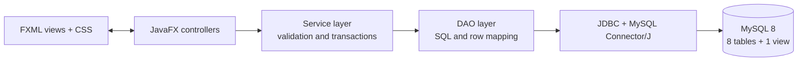
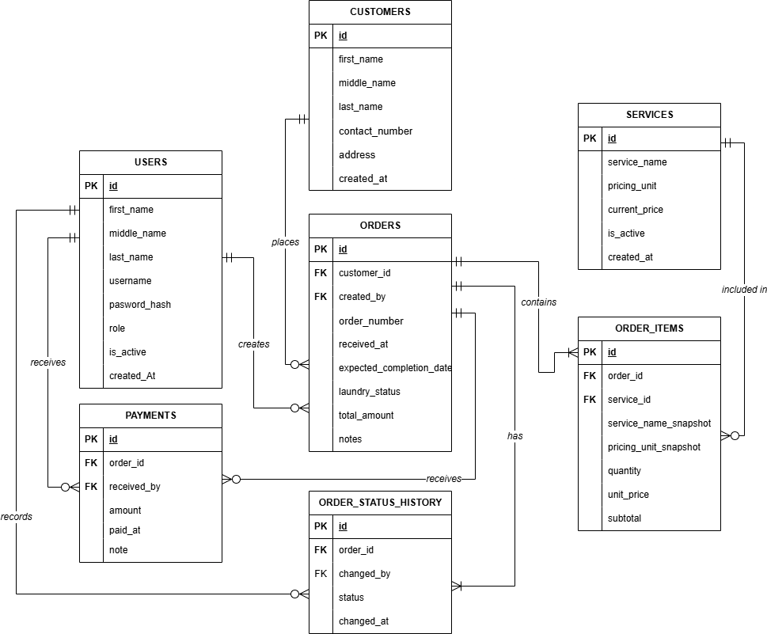

# LaundryLink

**A Java desktop application for managing day-to-day laundry shop operations in one database-backed workflow.**


LaundryLink replaces fragmented notebooks and manual calculations with a shop-scoped system for customers, service pricing, laundry orders, processing stages, cash payments, balances, and daily monitoring. Owners manage their shop configuration and staff accounts; authorized staff use the same operational records without receiving owner-only permissions.

This is a collaborative four-person Java NC III training project. My work focused on database setup and migrations, manual user acceptance testing, and coordinating the AI-assisted implementation of the **Services & Prices** module. The complete application was not developed by one person.

[Features](#core-capabilities) · [Architecture](#application-architecture) · [Database](#database-design) · [Setup](SETUP_GUIDE.md) · [ERD](erd.drawio.png) · [Team guide](TEAM_GUIDE.md)

## Problem and purpose

Small laundry shops often track customer information, service prices, orders, processing stages, payments, and outstanding balances in separate handwritten records. That approach makes incorrect charges, lost order context, and unclear balances more likely.

LaundryLink centralizes those records and preserves the operational history needed to answer practical questions: What did the customer order? Which price was charged? What stage is the laundry in? How much has been paid? Can the order be released?

## Core capabilities

| Module | Implemented behavior |
|---|---|
| **Account and shop management** | Register a shop and owner, authenticate users, update profiles, create/deactivate staff accounts, and enforce owner/staff permissions. |
| **Customer management** | Add, search, update, and conditionally delete customer records; inspect each customer's order history. |
| **Services and prices** | Create and update services, choose per-kilogram or per-piece pricing, activate/deactivate availability, and configure required washing, drying, and ironing stages. |
| **Laundry orders** | Select a customer, add one or more services, enter weight or piece quantity, calculate totals, search orders, and preserve service-name, pricing-unit, and price snapshots. |
| **Order processing** | Track Received, Washing, Drying, Ironing, Ready for Pickup, Released, or Cancelled states; retain status history and support controlled status corrections. |
| **Payments** | Record partial or full cash payments, calculate change, track remaining balances, and prevent overpayment. |
| **Dashboard and monitoring** | Review daily orders, collections, released/ready counts, outstanding balances, recent orders, and current workflow totals. |

## Application architecture

LaundryLink follows a layered Java desktop design rather than placing database logic directly in JavaFX screens.



| Layer | Location | Responsibility |
|---|---|---|
| Views | `src/com/laundrylink/view/`, `css/`, `images/` | FXML screen structure, visual styling, and interface assets |
| Controllers | `src/com/laundrylink/controller/` | JavaFX events, form state, table rendering, navigation, and role-aware controls |
| Services | `src/com/laundrylink/service/` | Validation, business rules, transaction boundaries, and module coordination |
| DAOs | `src/com/laundrylink/dao/` | Prepared SQL statements, persistence operations, and database result mapping |
| Models | `src/com/laundrylink/model/` | Users, customers, services, orders, payments, statuses, and view-specific records |
| Configuration/utilities | `src/com/laundrylink/config/`, `util/` | Database connections, sessions, navigation, dialogs, background work, and formatting |

## Important workflows

### Service configuration to historical order price

1. The owner defines a service name, pricing unit, current price, availability, and required stages.
2. Active services become available during order entry.
3. When an order is saved, `order_items` copies the service name, pricing unit, and unit price.
4. Later service-price changes affect new orders only; existing orders retain the price originally charged.

### Laundry processing and release

1. A new order starts as `RECEIVED` and receives an initial status-history record.
2. Staff move it through the configured Washing, Drying, and/or Ironing stages.
3. The order becomes `READY_FOR_PICKUP` when processing is complete.
4. Release requires the correct workflow state and a fully settled balance; the service layer records the transition.

### Cash payment and balance monitoring

1. The payment screen reads the order total and previous payments.
2. Staff record the amount applied to the order and the cash received.
3. The application validates positive values, sufficient cash, and a payment no greater than the remaining balance.
4. The `v_order_balances` view derives amount paid, remaining balance, and `UNPAID`, `PARTIALLY_PAID`, or `PAID` status.

## Database design

The current [`database/schema.sql`](database/schema.sql) is the source of truth. It creates **8 tables and 1 view**:

| Object | Type | Purpose |
|---|---|---|
| `shops` | Table | Registered laundry shops and tenant boundary |
| `users` | Table | Owner (`ADMIN`) and staff accounts |
| `customers` | Table | Shop customer records; customers do not have system accounts |
| `services` | Table | Service catalog, pricing, availability, and required stages |
| `orders` | Table | Order header, customer, creator, total, dates, and current status |
| `order_items` | Table | Services and historical pricing snapshots attached to an order |
| `payments` | Table | Partial or full cash payments and receiving user |
| `order_status_history` | Table | Timestamped status transitions and undo markers |
| `v_order_balances` | View | Derived amount paid, outstanding balance, and payment status per order |

The previous README's “7 tables” statement was outdated. The eighth table, `shops`, was introduced for multi-shop data isolation by `add-shops.sql` and is already included in the current full schema. `v_order_balances` is a database view, not a ninth table.

<details>
<summary><strong>View the entity-relationship diagram</strong></summary>



The editable source is available in [`ERD.drawio`](ERD.drawio).
</details>

## Technology stack

| Category | Technology |
|---|---|
| Language and runtime | Java 8 |
| Desktop UI | JavaFX 8, FXML, CSS |
| Database | MySQL 8.0, InnoDB |
| Data access | JDBC, MySQL Connector/J 8.4.0, prepared statements |
| Build tooling | Apache Ant, NetBeans project metadata |
| Security | Salted password hashing through Java's `PBKDF2WithHmacSHA256`; role- and shop-scoped application rules |
| Collaboration | Git, GitHub, feature branches, pull requests |

## Project structure

```text
src/com/laundrylink/
├── controller/     JavaFX screen controllers
├── service/        validation, workflows, and transactions
├── dao/            database access
├── model/          domain and presentation models
├── view/           FXML layouts
├── css/            screen styling
├── config/         connection configuration
├── util/           shared UI and session helpers
└── images/         interface assets

database/           full schema, migrations, sample data, and DB notes
docs/               module-level technical documentation
nbproject/          NetBeans/Ant project configuration
lib/                MySQL Connector/J
```

## Setup and installation

Follow the tested, step-by-step instructions in [`SETUP_GUIDE.md`](SETUP_GUIDE.md). In summary, the project requires:

- JDK 8 with JavaFX included;
- Apache NetBeans 8.2 or a compatible Ant workflow;
- MySQL Server and Workbench 8.0; and
- a local `config/database.properties` copied from the committed example.

For a fresh database, execute:

1. `database/schema.sql`
2. `database/create-app-user.sql` after replacing the placeholder password
3. optionally, `database/sample-data.sql` after registering the first shop

Existing installations should follow [`database/DATABASE_CHANGES.md`](database/DATABASE_CHANGES.md) rather than rerunning migrations blindly.

No real database password is committed. `config/database.properties` is intentionally ignored by Git.

## Testing and validation

- Manual user acceptance testing was performed across owner and staff journeys, including authentication, shop/staff setup, customer and service management, order creation, status progression, payments, release rules, and dashboard updates.
- Database migrations were applied and checked against the final schema during team integration.
- An order-status usability issue was identified during UAT; a teammate implemented the interface correction, and the corrected behavior was verified afterward.
- Module-specific manual checks are documented in [`docs/service-price-management.md`](docs/service-price-management.md) and [`TEAM_GUIDE.md`](TEAM_GUIDE.md).
- A clean Ant build completed successfully and compiled all 60 Java source files into the application JAR.

The repository does **not** contain an automated unit, integration, or UI test suite, coverage report, or formal UAT result file. No automated coverage percentage is claimed.

## Collaboration and attribution

| Contributor | Primary project responsibility |
|---|---|
| **Ken Romanggar** | Lead development; accounts, shop registration, laundry orders, payments, dashboard, and shared code |
| **Edmar Mabajen** | Interface design leadership and Customer Management |
| **Reniel Galang** | Business-plan leadership and Services & Prices module coordination |
| **John Ray Fullece** | Documentation leadership and Order Status Tracking |

### My contribution — Reniel Galang

- Executed local MySQL setup and schema migrations during integration.
- Coordinated AI-assisted implementation of the Services & Prices module and reviewed it against the agreed validation, pricing-unit, availability, stage, and owner-permission requirements.
- Conducted manual UAT across the integrated desktop application.
- Identified an order-status usability issue and verified the correction implemented by a teammate.
- Participated in Git/GitHub collaboration, documentation, and project presentation work.

AI assistance supported parts of the development workflow; requirements, integration decisions, manual verification, and final team ownership remained human responsibilities. Commit history and merged feature branches provide additional implementation attribution.

## Known limitations

- The current product is a desktop application backed by a directly configured MySQL database; it is not a hosted multi-device web service.
- Payments are cash-only, with no payment-gateway integration.
- Customers are managed records, not system users; there is no customer-facing portal or notification service.
- Runtime application screenshots are not currently committed, although the repository includes the ERD and UI assets.
- Quality assurance is manual because no automated test suite is included.

## Documentation

- [Complete setup guide](SETUP_GUIDE.md)
- [Database migration guide](database/DATABASE_CHANGES.md)
- [Service and Price Management specification](docs/service-price-management.md)
- [Team architecture and module guide](TEAM_GUIDE.md)
- [Entity-relationship diagram](erd.drawio.png)

## Recommended portfolio captures

For a stronger visual walkthrough, capture the real running application at the Welcome/Login screen, Dashboard, Customers, Services & Prices, New Order, Order Status, Payments, and Staff Accounts. These screenshots should use demonstration data and must not expose real customer information or database credentials.
